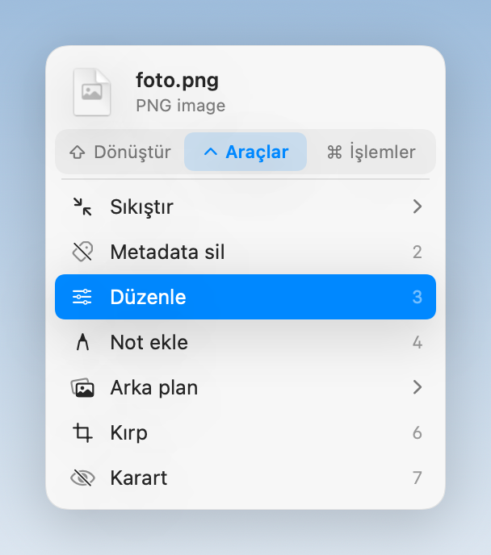

# Shiftlist

Select files in Finder, tap **Shift** once, and a small list opens under your cursor: convert, edit, compress or share without opening another app.



| Key | Tab | What's inside |
| --- | --- | --- |
| ⇧ Shift | Convert | JPG, PNG, HEIC, AVIF, PDF, MP4, MP3, DOCX, ZIP, SRT/VTT subtitles… |
| ⌃ Control | Tools | compress, strip metadata, crop, redact, trim, speed, split, collage, join videos, waveform video, read QR codes… |
| ⌘ Command | Actions | AirDrop, pin on screen, copy, move, copy path, Terminal |

Pick with the mouse, the arrow keys, or 1–9. Esc closes. New files are always written next to the original; the original is never touched.

The interface is in English and Turkish and follows your system language.

## Requirements

- Apple silicon or Intel Mac
- macOS 14 or later (macOS 26 for the glass look and the bundled ffmpeg)
- On Intel Macs the bundled ffmpeg isn't used; video and audio tools need `brew install ffmpeg`
- Optional: [pandoc](https://pandoc.org) for Markdown / EPUB conversion, Pages for better Word → PDF

## Build

```sh
./scripts/make-signing-cert.sh   # once: a local signing identity so macOS remembers permissions across rebuilds
./scripts/build.sh --install     # builds and installs to /Applications
./scripts/dist.sh                # builds Shiftlist.dmg with ffmpeg bundled
```

On first launch, allow **Accessibility** (to notice the Shift tap) and **Finder automation** (to read the selection).

## Acknowledgments

Collage, joining videos, waveform video, QR code reading and SRT ↔ VTT subtitle conversion were inspired by
[Nashi](https://github.com/orkunisitmak/nashi-app) by Orkun Işıtmak (MIT). Shiftlist's implementations are its own; no Nashi code is included.

## License

MIT. The DMG built by `scripts/dist.sh` bundles [FFmpeg](https://ffmpeg.org), which is licensed under the GPL; its source code is available at https://ffmpeg.org/download.html.
